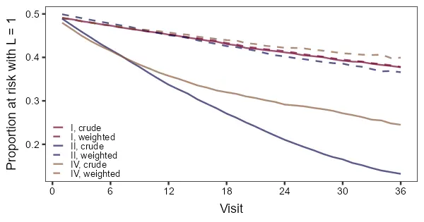
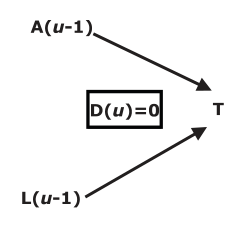
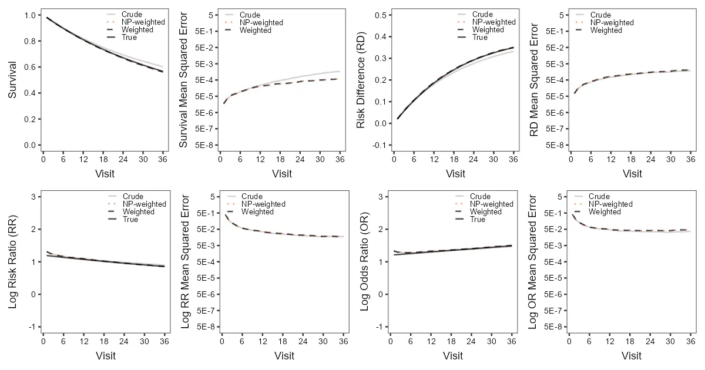
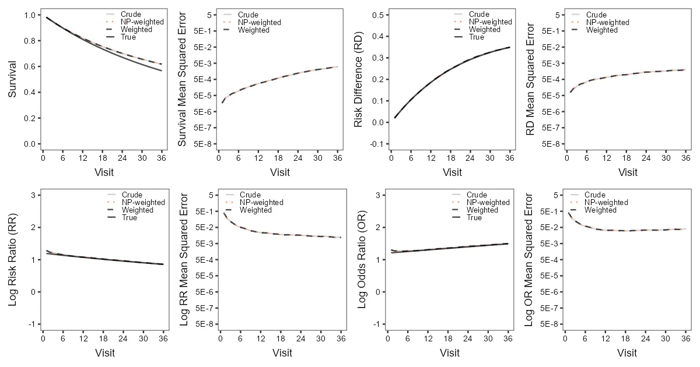
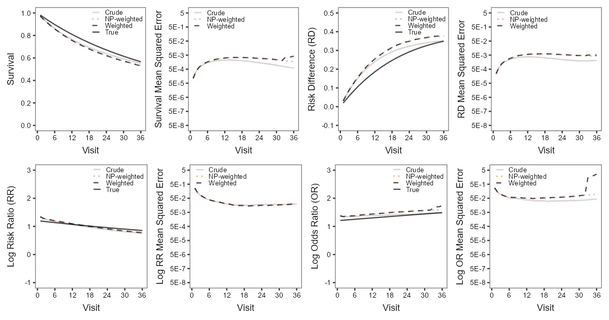

# Simulation replication of Howe et al. (2016)


- [Background](#s-background)
  - [Motivating example](#motivating-example)
  - [Estimation](#estimation)
    - [Inverse probability of censoring
      weights](#inverse-probability-of-censoring-weights)
- [Simulation details](#s-simulation-details)
  - [Code demonstration](#code-demonstration)
- [Results](#s-results)
  - [Simulation 1: Figure 1, Diagram I and Figure
    A1.1](#simulation-1-figure-1-diagram-i-and-figure-a11)
- [Appendix](#appendix)
- [References](#s-references)

# Background

Many studies in medicine and epidemiology feature censoring, where some
phenomenon (e.g., patient dropout) prevents us from observing the
outcome of interest (e.g., patient remission). Data from such studies
must be analyzed using specialized time-to-event or survival analysis
techniques. However, the most common techniques assume to some degree
that censoring is random; in other words, that it is uninformative
([Clark et al. 2003](#ref-clarketal2003a); [Jackson et al.
2014](#ref-jacksonetal2014a)). Not accounting for informative censoring
can lead to selection bias and potentially misleading results ([Lu et
al. 2022](#ref-luetal2022a)). In [“Selection Bias Due to Loss to Follow
Up in Cohort
Studies”](https://pmc.ncbi.nlm.nih.gov/articles/PMC5008911), Howe et al.
([2016](#ref-howeetal2016a)) explore how informative censoring can lead
to selection bias and how this can be addressed in statistical analyses.
This repository aims to replicate (and, to a small degree, extend) the
simulation results presented in the paper.

## Motivating example

Howe et al. ([2016](#ref-howeetal2016a)) outline a study of people
living with HIV. In a sample of $n$ patients, we track time in terms of
the number of visits since study entry, indexed by $u$. Denote time to
death as $T$, time to loss to follow up as $C$, and time to study end as
$M$. As we’ll only be able to observe the earliest of these for each
patient, let $Y = \min(T, C, M)$. We define indicators for death and
loss to follow up at visit $u$ as $O(u)$ and $D(u)$, respectively. In
the primary simulations, our exposure of interest is injection drug use,
$A$ (1: yes, 0: no), and another covariate is heavy alcohol use, $L$ (1:
yes, 0: no). An elaboration of the primary simulation adds two
additional covariates: CD4 cell count (a clinical marker of HIV
progression; 1: $\ge 200$ per microliter, 0: $\lt 200$ per microliter)
and level of education (1: college degree, 0: no college degree). A
secondary simulation designed to emulate the real-world data analysis
presented in the paper uses African American race as its main covariate
and a composite variable as a second covariate. For variables whose
values can change over time, we can specify the value at the time of a
particular visit; for example, $A(u)$ represents injection drug use
status at visit $u$. The goal of the analyses is to estimate the effect
of injection drug use (or, for the secondary simulation, African
American race) on time to death.

A typical analysis would estimate the survival function at each visit
$S(u) = P(T > u)$; that is, the probability of being alive at $u$. The
complement of the survival function gives us a measure of risk over
time, $1 - S(u) = P(T \le u)$. By estimating $S(u)$ separately at each
level of the exposure of interest—i.e., $S(u \mid A = 1)$ versus
$S(u \mid A = 0)$—we can compare the risks in each group over time to
generate measures of effect. The simulations of Howe et al.
([2016](#ref-howeetal2016a)) present the overall survival function,
$S(u)$, along with three effect measures  
1. the risk difference (RD)

$$
RD(u) = \left[ 1 - S(u \mid A = 1) \right] - \left[ 1 - S(u \mid A = 0) \right],
$$

2.  the log risk ratio (RR)

$$
\log RR(u) = \log \left( \frac{ 1 - S(u \mid A = 1) }{ 1 - S(u \mid A = 0) } \right),
$$

3.  the log odds ratio (OR)

$$
\log OR(u) = \log \left( \frac{ \left[ 1 - S(u \mid A = 1) \right] / S(u \mid A = 1) }{ \left[ 1 - S(u \mid A = 0) \right] / S(u \mid A = 0) } \right).
$$

For each measure, an estimate greater than zero indicates higher risk of
the outcome in the exposed group, $A = 1$.

## Estimation

To estimate these measures from observed data, we start with the hazard
function, $\lambda(u)$, defined as $\lambda(u) = P(T = u \mid T \ge u)$;
in words, the probability of experiencing the event at visit $u$ given
that one has survived until at least visit $u$. The hazard function is
related to the survival function through
$S(u) = \prod_{k=1}^u 1 - \lambda(k)$. An intuitive way of estimating
$\lambda(u)$ is

$$
\hat{\lambda}(u) = \frac{ \text{ number of individuals who experience the event at visit $u$ } }{ \text{ number of individuals at risk at visit $u$ } },
$$

where the number at risk is the number of individuals who haven’t
experienced the event or been censored prior to visit $u$ ([Tutz and
Schmid 2016](#ref-tutzandschmid2016a)). We can then estimate the overall
survival function using a cumulative product of the hazard function
estimates

$$
\hat{S}(u) = \prod_{k=1}^u 1 - \hat{\lambda}(k).
$$

To estimate the three effect measures, we stratify the calculation of
$\hat{\lambda}(u)$ by exposure and plug the exposure-specific survival
function estimates into the definitions above.

### Inverse probability of censoring weights

However, as mentioned at the start, this method assumes that censoring
is random. Howe et al. ([2016](#ref-howeetal2016a)) offer two solutions:
stratification and inverse probability of censoring (IPC) weighting.
Stratification simply involves estimating the hazard function in finer
subsets of the sample defined by combinations of the values of the
variables that influence censoring, but this becomes impractical as the
number of variables increases or if continuous covariates are to be
included. IPC weighting is a more general approach that reweights the
contribution of each patient over the course of follow up by their
estimated probability of becoming lost to follow up. This reweighting
breaks the dependence between censoring and the variables used to
estimate the weights.

IPC weights can be defined using quantities similar to those described
above. If we consider the probability of not being lost to follow up at
each visit given values of our exposure and covariate—in other words,
the survival function with respect to censoring at visit $u$,
$S_{\text{cens}}(u \mid A, L) = P(C > u \mid A, L)$, then the IPC weight
at visit $u$ is

$$
W(u) = \frac{ 1 }{ S_{\text{cens}}(u \mid A, L) }.
$$

Viewed from the perspective of the hazard of censoring at visit $u$
given values of our exposure and covariate,
$\lambda_{\text{cens}}(u \mid A, L) = P(C = u \mid C \ge u, 1, A, L)$,
then the weight at visit $u$ is

$$
W(u) = \frac{ 1 }{ \prod_{k=1}^u 1 - \lambda_{\text{cens}}(k \mid A, L) } = \frac{ 1 }{ \prod_{k=1}^u P[C = k \mid C \ge k, A, L] }.
$$

Weights are set to zero for patients at the visit where they are lost to
follow up.

#### Stabilizing weights

In studies with many covariates, patients with rare combinations of
covariate values may end up with large weights, giving those patients
disproportionate influence in analyses and increasing the variance of
effect estimates. We can solve this problem through the use of
stabilized weights by replacing the numerator in the previous equation
with the hazard of censoring given only exposure,

$$
SW(u) = \frac{ \prod_{k=1}^u 1 - \lambda_{\text{cens}}(k \mid A) }{ \prod_{k=1}^u 1 - \lambda_{\text{cens}}(k \mid A, L) }.
$$

In contrast to the unstabilized weights, stabilized weights are not set
to zero at the visit where patients become lost to follow up.

Estimation can be done nonparametrically or parametrically.
Nonparametric estimation is similar to stratification, where now we
estimate the weights in subsets of patients defined by unique
combinations of covariate values. As before, this becomes impractical as
the number of covariates grows or if any continuous covariates are used.
Parametric estimation involves the use of a model such as pooled
logistic regression to estimate the quantities used to compute the
weights. The simulations of Howe et al. ([2016](#ref-howeetal2016a))
estimate weights nonparametrically, but a parametric approach would be
more common in practce. The replication results presented below use both
methods and demonstrate that the choice is not entirely straightforward
even in the simple scenario outlined by Howe et al.
([2016](#ref-howeetal2016a)).

# Simulation details

Details of the simulations can be found in the paper’s [supplementary
material](https://pmc.ncbi.nlm.nih.gov/articles/PMC5008911/#SD1). All
simulations involve building cohorts through pseudorandom number
sampling. Results presented here were generated using R version 4.5, and
all code can be found in [howeetal2016.R](./howeetal2016.R). Simulation
scenarios are differentiated by their underlying data-generating
processes. These are coded as functions named `make_data_*()`. A
simulation run involves passing the name of one of these functions to
the main function `sim()` along with the number of simulations, the
number of observations in each fake data set, and an optional random
number seed. The job of `sim()` is to collect the results of calling the
real workhorse function `sim_1()`, which produces a single fake data set
and runs three analyses: (1) a naive analysis, (2) an IPC-weighted
analysis with nonparametrically estimated weights, and (3) an
IPC-weighted analysis with parametrically estimated weights.
Parallelization is achieved through the use of the
[furrr](https://furrr.futureverse.org/) package, a member of the
[futureverse](https://www.futureverse.org/) family of packages.

## Code demonstration

To illustate the code, we can examine the impact of informative
censoring on an intermediate quantity—the frequency of the covariate $L$
in the sample over time—and how IPC weighting counteracts the effects.

We’ll begin by simulating from three of the data-generating processes.

``` r
set.seed(21152538)
f1d1_dat <- make_data_f1d1(1000)
f1d2_dat <- make_data_f1d2(1000)
f1d4_dat <- make_data_f1d4(1000)
f1d1_dat
```

    # A tibble: 1,000 × 9
          id     a     l death_time censor_time study_end observed_time  lost  died
       <int> <int> <int>      <int>       <int>     <int>         <int> <int> <int>
     1     1     1     0         20           2        36             2     1     0
     2     2     0     0        147          38        36            36     0     0
     3     3     0     0        489         151        36            36     0     0
     4     4     0     1         21          11        36            11     1     0
     5     5     0     0        117           4        36             4     1     0
     6     6     0     0         16          23        36            16     0     1
     7     7     1     0        100         361        36            36     0     0
     8     8     0     1         95          16        36            16     1     0
     9     9     0     0        253         146        36            36     0     0
    10    10     0     0        150          75        36            36     0     0
    # ℹ 990 more rows

A simulated data set consists of a patient identifier, the exposures $A$
and covariate $L$, times to death, loss to follow up, and study end, the
patient’s observed time, and indicators for whether the patient died or
was lost to follow up at the end of observation.

Censoring is random in the first scenario and informative in the second
and third scenarios, being dependent on $L$ in the second and both $A$
and $L$ in the third (see below for further details). In all scenarios,
$L$ increases the risk of death, so we would expect the frequency of $L$
to decline over time as a disproportionate share of individuals with
$L = 1$ die. Because $L$ also increases the risk of censoring in the
second and third scenarios, we can expect a further decrease. Thus, the
difference between the frequency of $L$ in the scenario without
informative censoring compared to the scenarios with informative
censoring gives us an opportunity to observe the level of selection bias
as well as how weighting counteracts the effect.

To perform the IPC weighted analysis, we first pass a simulated data set
through a function that tranforms it from a one-patient-per-row format
to a one-patient-per-visit-per-row format. Then we estimate stabilized
weights parametrically using pooled logistic regression and finally
collapse visits with identical values to reduce the size of the data
set.

``` r
f1d1_wdat <- f1d1_dat |>
  expand_singly(
    observed_time,
    invariants = c(id, a, l),
    events = c(lost, died),
    var = observed_time
  ) |>
  estimate_ipcw(
    formula_numer = lost == 0 ~ 0 + factor(observed_time) * a,
    formula_denom = lost == 0 ~ 0 + factor(observed_time) * a * l,
    id = id,
    censored = lost
  ) |>
  collapse_intervals(
    interval = observed_time,
    events = c(lost, died),
    invariants = c(id, a, l, wt, swt)
  )
f1d1_wdat
```

    # A tibble: 22,223 × 9
          id     a     l    wt   swt observed_time_start observed_time_end  lost
       <int> <int> <int> <dbl> <dbl>               <dbl>             <dbl> <int>
     1     1     1     0  1.00  1.00                   1                 1     0
     2     1     1     0  0     1.01                   2                 2     1
     3     2     0     0  1.01  1.00                   1                 1     0
     4     2     0     0  1.05  1.02                   2                 2     0
     5     2     0     0  1.06  1.01                   3                 3     0
     6     2     0     0  1.09  1.03                   4                 4     0
     7     2     0     0  1.12  1.04                   5                 5     0
     8     2     0     0  1.15  1.04                   6                 6     0
     9     2     0     0  1.16  1.04                   7                 7     0
    10     2     0     0  1.17  1.04                   8                 8     0
    # ℹ 22,213 more rows
    # ℹ 1 more variable: died <int>

Notice that when patient 1 is lost to follow up at visit 2, the
unstabilized weight is zero, but the stabilized weight is not, as noted
[above](#inverse-probability-of-censoring-weights).

We then graph the proportion of patients with $L = 1$ at each visit in
the different scenarios.

<figure>

<figcaption>
Figure 0: The effect of informative censoring and inverse probability of
censoring weighting on the frequency of a covariate over time.
</figcaption>
</figure>

The frequency of $L$ taking the weights into account in scenarios two
and three is very similar to that in scenario one.

# Results

## Simulation 1: Figure 1, Diagram I and Figure A1.1

Howe et al. ([2016](#ref-howeetal2016a)) use causal diagrams to visually
define how variables and outcomes are related to one another, with
arrows representing causal relationships ([Greenland, Pearl, and Robins
1999](#ref-greenlandetal1999a)). Their Figure 1, Diagram I presents the
simplest version of the primary simulation.

<figure>

<figcaption>
Figure 1, Diagram 1: Directed acyclic graph for a scenario without
selection bias due to loss to follow up. Notation: <em>A</em>, injection
drug use (exposure of interest); <em>D</em>, loss to follow up;
<em>L</em>, heavy alcohol use (potential confounder); <em>T</em>, death
(outcome). <em>u</em> denotes time in terms of clinic visit number, and,
e.g., <em>A(u)</em> represents injection drug use status at visit
<em>u</em>. Arrows indicate causal effects. The box around <em>D(u) =
0</em> represents selection, meaning that, in order to remain in the
study, a patient must not have been lost to follow up.
</figcaption>
</figure>

Both injection drug use $A$ and heavy alcohol use $L$ directly raise the
risk of death $T$; neither variable causes loss to follow up. In this
and subsequent diagrams, the exposure and covariate are written as if
they were time-varying—e.g., the arrow between $A(u - 1)$ and $T$
implies that injection drug use status at the previous visit affects
risk of death by the next visit—however, exposure and covariates are
fixed at baseline by design in the simulations.

Times to death and loss to follow up are generated from exponential
distributions with mean parameters $\mu_{\text{death}}$ and
$\mu_{\text{cens}}$ (generically symbolized by $\mu_1$ and $\mu_2$ in
the appendix). The influences of $A$ and $L$ on $T$ are the result of
multiplying $\mu_{\text{death}}$ by $0.30$ for patients with $A = 1$, by
$0.41$ for patients with $L = 1$, and by $0.30 \times 0.41 = 0.123$ for
patients with $A = 1$ and $L = 1$. Values of $A$ and $L$ are
independently sampled from a Bernoulli distribution with probability
$0.5$.

An immediate difficulty we encounter is that the parameters for the
exponential distributions representing time to death and time to loss to
follow up cannot be correct. TODO.


See Figure A1.1, Version 2 in the [Appendix](#appendix).









# Appendix


# References

<div id="refs" class="references csl-bib-body hanging-indent"
entry-spacing="0">

<div id="ref-clarketal2003a" class="csl-entry">

Clark, T G, M J Bradburn, S B Love, and D G Altman. 2003. “Survival
Analysis Part i: Basic Concepts and First Analyses.” *British Journal of
Cancer* 89 (2): 232–38. <https://doi.org/10.1038/sj.bjc.6601118>.

</div>

<div id="ref-greenlandetal1999a" class="csl-entry">

Greenland, Sander, Judea Pearl, and James M. Robins. 1999. “Causal
Diagrams for Epidemiologic Research.” *Epidemiology* 10 (1): 37–48.
<https://doi.org/10.1097/00001648-199901000-00008>.

</div>

<div id="ref-howeetal2016a" class="csl-entry">

Howe, Chanelle J., Stephen R. Cole, Bryan Lau, Sonia Napravnik, and
Joseph J. Eron. 2016. “Selection Bias Due to Loss to Follow up in Cohort
Studies.” *Epidemiology* 27 (1): 91–97.
<https://doi.org/10.1097/ede.0000000000000409>.

</div>

<div id="ref-jacksonetal2014a" class="csl-entry">

Jackson, Dan, Ian R. White, Shaun Seaman, Hannah Evans, Kathy Baisley,
and James Carpenter. 2014. “Relaxing the Independent Censoring
Assumption in the Cox Proportional Hazards Model Using Multiple
Imputation.” *Statistics in Medicine* 33 (27): 4681–94.
<https://doi.org/10.1002/sim.6274>.

</div>

<div id="ref-luetal2022a" class="csl-entry">

Lu, Haidong, Stephen R. Cole, Chanelle J. Howe, and Daniel Westreich.
2022. “Toward a Clearer Definition of Selection Bias When Estimating
Causal Effects.” *Epidemiology* 33 (5): 699–706.
<https://doi.org/10.1097/ede.0000000000001516>.

</div>

<div id="ref-tutzandschmid2016a" class="csl-entry">

Tutz, Gerhard, and Matthias Schmid. 2016. *Modeling Discrete
Time-to-Event Data*. *Springer Series in Statistics*. Springer
International Publishing. <https://doi.org/10.1007/978-3-319-28158-2>.

</div>

</div>
